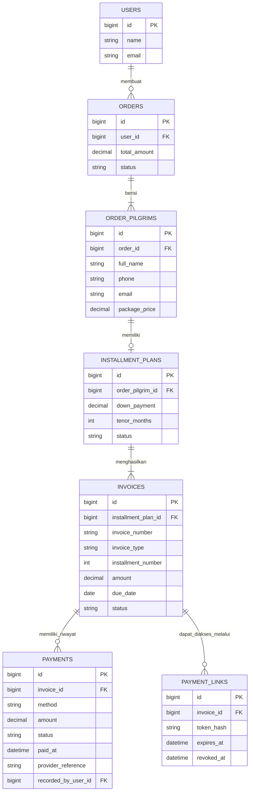

# Kesimpulan Desain Sistem Cicilan Pembayaran

Dokumen ini merangkum rancangan sederhana sistem pembayaran cicilan untuk pemesanan paket umrah.

## 1. Aturan bisnis utama

1. **Satu pesanan dapat berisi beberapa jamaah.** Pemesan yang memiliki akun dapat mendaftarkan jamaah lain yang belum mempunyai akun.
2. **Setiap jamaah memiliki rencana cicilan sendiri.** Tenor, DP, nominal, dan jadwal cicilan dapat berbeda untuk setiap jamaah dalam satu pesanan.
3. **Setiap invoice wajib dibayar lunas dalam satu pembayaran.** Sistem tidak menerima pembayaran sebagian untuk sebuah invoice/cicilan.
4. **Satu invoice dibuat untuk setiap kewajiban pembayaran**, misalnya invoice DP dan invoice cicilan bulan 1, bulan 2, dan seterusnya.
5. **Jatuh tempo tetap digunakan.** Invoice yang belum lunas setelah tanggal jatuh tempo ditandai sebagai terlambat. Tanggal dan nominal invoice lama tidak diubah hanya karena pelanggan terlambat membayar.
6. **Metode pembayaran dipilih ketika pelanggan membayar**, bukan dikunci pada rencana cicilan. Pelanggan dapat memilih metode yang tersedia untuk setiap invoice.
7. **Metode pembayaran yang tersedia:**
   - Kartu kredit (*credit card*) melalui penyedia pembayaran yang mendukungnya.
   - Transfer bank melalui metode yang disediakan sistem.
   - Tunai (*cash*) dengan datang langsung ke kantor agen travel yang menangani paket tersebut. Staf agen mencatat pembayaran ke sistem.
8. **Jamaah tidak wajib memiliki akun.** Pemesan dapat membayar dari dashboard akunnya. Jika jamaah ingin membayar sendiri, pemesan dapat membagikan tautan pembayaran aman untuk invoice tertentu.

## 2. Peran dan tanggung jawab

- **Pemesan (`users`)**: membuat pesanan, memasukkan data jamaah, memilih rencana cicilan untuk setiap jamaah, dan secara default mengelola pembayaran pesanan.
- **Jamaah (`order_pilgrims`)**: orang yang akan berangkat. Data jamaah dalam pesanan tidak harus terhubung ke akun pengguna.
- **Agen travel/staf**: menerima pembayaran tunai di kantor, memverifikasi transfer manual jika digunakan, lalu mencatat atau mengonfirmasi pembayaran di sistem.
- **Sistem**: membuat invoice sesuai jadwal, menampilkan jatuh tempo, memeriksa nominal pembayaran, dan memperbarui status setelah pembayaran berhasil diverifikasi.

## 3. ERD sederhana

### Relasi antartabel

- `users` **1:N** `orders`: satu pemesan dapat membuat banyak pesanan.
- `orders` **1:N** `order_pilgrims`: satu pesanan dapat mencakup beberapa jamaah.
- `order_pilgrims` **1:0..1** `installment_plans`: setiap jamaah dalam pesanan dapat mempunyai satu rencana cicilan, atau tidak memilikinya jika pembayarannya lunas sekaligus.
- `installment_plans` **1:N** `invoices`: satu rencana menghasilkan invoice DP dan invoice cicilan sesuai jadwal.
- `invoices` **1:N** `payments`: satu invoice dapat memiliki beberapa percobaan pembayaran, misalnya percobaan kartu gagal lalu transfer berhasil. Namun, **maksimal satu pembayaran yang berhasil melunasi invoice**.
- `invoices` **1:N** `payment_links`: invoice dapat memiliki tautan pembayaran untuk jamaah tanpa akun. Tautan harus menggunakan token acak yang sulit ditebak, memiliki batas waktu dan bisa dicabut.

> ERD ini bersifat konseptual. Tipe ID, kolom audit, relasi staf/agen, dan aturan unik perlu disesuaikan dengan skema aplikasi sebenarnya.

## 4. Status invoice dan pembayaran

### Status invoice

Sederhanakan status tersimpan menjadi:

- `unpaid`: belum lunas.
- `paid`: sudah lunas.
- `cancelled`: tagihan dibatalkan secara sah.

Label **Terlambat** sebaiknya dihitung dari kondisi `status = unpaid` dan `due_date < tanggal_hari_ini`, bukan dijadikan status permanen yang harus diperbarui secara manual. Pada UI, status jatuh tempo bisa tampil sebagai `Belum dibayar`, `Jatuh tempo hari ini`, `Terlambat`, atau `Lunas`.

### Status pembayaran

- `pending`: pembayaran sedang menunggu penyelesaian atau verifikasi.
- `succeeded`: pembayaran berhasil.
- `failed`: percobaan pembayaran gagal.
- `expired`: sesi atau instruksi pembayaran kedaluwarsa, jika metode pembayaran mendukung status ini.

Invoice baru ditandai `paid` setelah pembayaran berhasil dikonfirmasi oleh penyedia pembayaran atau diverifikasi oleh staf untuk metode manual/tunai.

## 5. Aturan penting: tidak ada pembayaran sebagian

- Nominal pembayaran untuk satu invoice harus sama dengan **sisa tagihan invoice**. Pada rancangan ini, karena invoice tidak boleh dibayar sebagian, sisa tagihan sama dengan nominal invoice selama belum lunas.
- Jika nominal yang dimasukkan kurang dari total invoice, sistem menolak pembayaran tersebut atau meminta pelanggan melanjutkan dengan nominal yang benar.
- Jika nominal melebihi total invoice, sistem menolak nominal tersebut atau mengarahkan pengguna ke alur lain yang disetujui bisnis. Jangan otomatis menganggap kelebihannya sebagai pembayaran invoice berikutnya.
- Pembayaran yang masih `pending` tidak langsung membuat invoice lunas.
- Percobaan pembayaran gagal tidak mengubah nominal, nomor, atau tanggal jatuh tempo invoice.
- Untuk versi pertama, satu pembayaran menangani **satu invoice secara penuh**. Jika ke depannya pelanggan dapat membayar beberapa invoice sekaligus, tambahkan tabel `payment_allocations` sebagai penghubung pembayaran dan invoice, dengan setiap invoice tetap harus dilunasi sepenuhnya.

## 6. Contoh ketika cicilan terlambat

Misalnya invoice cicilan ke-3 sebesar Rp4.000.000 jatuh tempo pada 10 Oktober tetapi belum dibayar. Invoice cicilan ke-4 sebesar Rp4.000.000 terbit dengan jatuh tempo 10 November.

Jika pelanggan membayar cicilan ke-3 pada 15 November:

1. Pelanggan memilih invoice cicilan ke-3 dan membayar penuh Rp4.000.000.
2. Setelah pembayaran berhasil diverifikasi, invoice ke-3 menjadi `paid`.
3. Riwayat tetap menunjukkan bahwa invoice ke-3 pernah terlambat.
4. Invoice ke-4 tetap belum dibayar dan dapat ditandai terlambat apabila tanggal jatuh temponya juga sudah lewat.
5. Pembayaran tidak otomatis dialihkan ke invoice ke-4. Pelanggan harus memilih invoice yang hendak dibayar, atau sistem harus menerapkan aturan alokasi yang dinyatakan secara jelas.

## 7. Halaman UI yang disarankan

- **Detail pesanan**: daftar jamaah, harga masing-masing, tenor, total pembayaran, total tunggakan, dan jadwal cicilan.
- **Halaman invoice**: invoice DP/cicilan, nominal, jatuh tempo, dan label status.
- **Halaman pembayaran**: pilih metode yang tersedia untuk invoice yang dipilih; nominal tidak dapat diedit dan harus dibayar penuh.
- **Halaman transaksi**: riwayat seluruh percobaan dan pembayaran yang berhasil, termasuk metode dan referensi pembayaran.
- **Panel agen**: pencatatan tunai dan verifikasi pembayaran yang memerlukan pemeriksaan manual.

## 8. Ringkasan keputusan

**Rencana cicilan melekat pada setiap jamaah dalam pesanan; invoice dibuat untuk setiap DP/cicilan; metode pembayaran dipilih per pembayaran; setiap invoice harus dilunasi penuh; jatuh tempo tetap berlaku; dan jamaah tanpa akun dapat membayar melalui tautan invoice yang aman atau melalui pemesan.**
